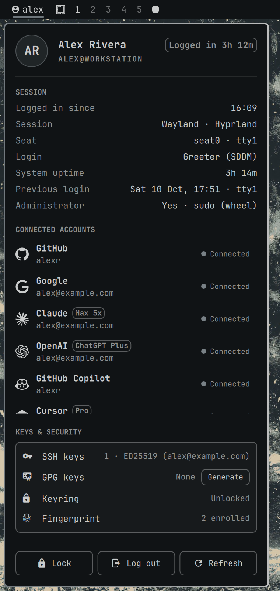
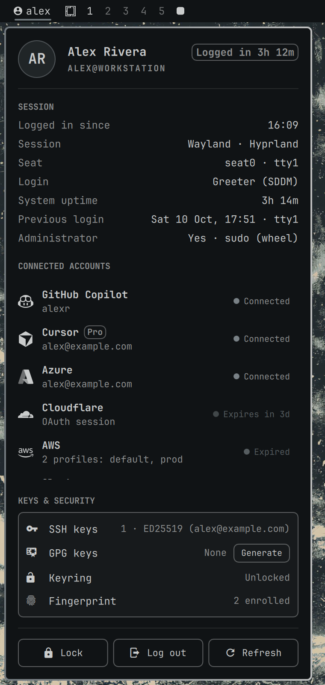
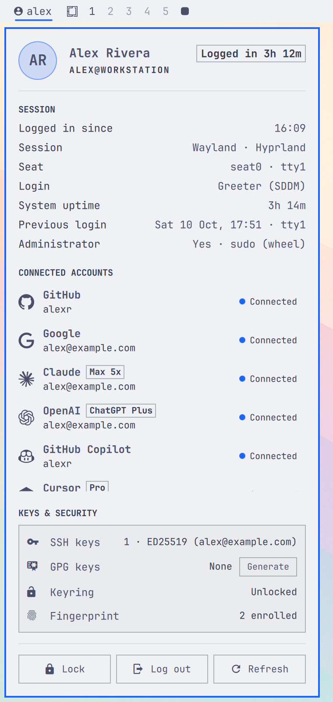
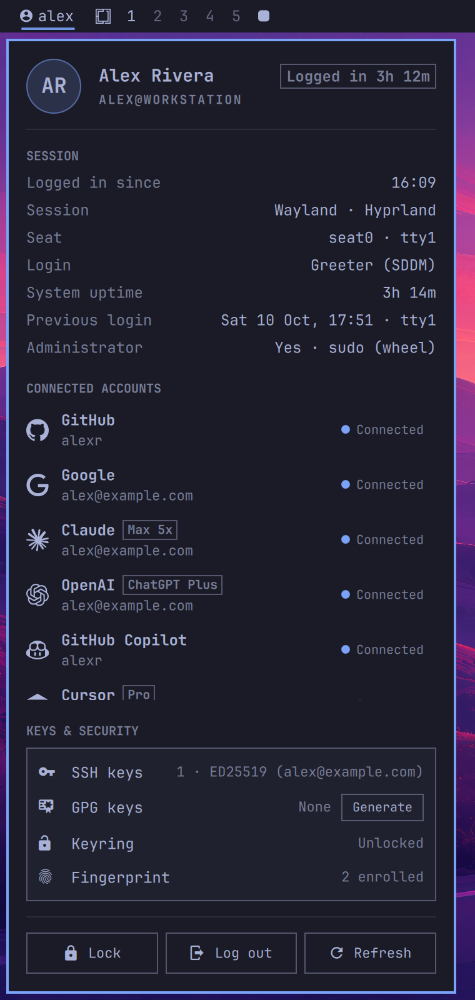

# User Menu for Omarchy

**Who you are on this machine, in one click.** User Menu puts your username in the Omarchy bar. Click it to see your session, every account signed in on this workstation, the state of your keys, and buttons to lock or log out. Its colors, fonts and borders come from your Omarchy theme.

<p align="center">
  
</p>

```bash
omarchy plugin add https://github.com/TannerBurns/omarchy-user-menu
```

## Features

- **Your identity in the bar.** Show your username, full name, hostname, `user@host`, or only an icon. Right-click the widget to cycle through them.
- **Session details at a glance.** See when you logged in and for how long, the session type and compositor, your seat and TTY, how you logged in (greeter, autologin or SSH), system uptime, your previous login, and whether you have sudo. Durations use clock time, so a suspend doesn't throw them off.
- **Connected accounts.** It finds 32 kinds of accounts across code hosts, AI tools, cloud CLIs, desktop apps and password managers. Each row shows the account name, the plan where known (*Max 5x*, *ChatGPT Plus*, *Pro*) and a status: **Connected**, **Expires in 3d**, **Expired** or **Signed out**. The list scrolls once it passes 5½ rows, and shrinks on short screens, so the menu never outgrows the display.
- **Keys & security.** Shows your SSH keys, GPG keys, whether the login keyring is unlocked, and fingerprint enrollment. If something is missing, a **Generate** or **Set up** button opens a terminal to fix it.
- **Lock / Log out / Refresh.** Logging out asks first, and Cancel is pre-selected.
- **Follows your theme.** Colors, fonts, spacing and corner radius come from the active Omarchy theme. Provider logos are single-colour and tinted to match, and everything restyles immediately on `omarchy theme set`, even with the menu open. Vertical bars are supported too.
- **Keyboard-driven.** Open it with a hotkey, scroll with `j`/`k`, move between buttons with `h`/`l`, press `Enter` to activate and `Esc` to close.
- **Private by design.** Everything is read locally from files. Nothing goes over the network, and secrets are never read (see [Privacy](#privacy)).

## Screenshots

| Dark (Solitude) | Scrolled accounts | Light (Catppuccin Latte) | Tokyo Night |
|---|---|---|---|
|  |  |  |  |

*Screenshots use the plugin's demo mode, which shows a fictional user and accounts.*

## Install

```bash
omarchy plugin add https://github.com/TannerBurns/omarchy-user-menu
```

Omarchy shows its standard warning about third-party plugins, clones the repository, and asks whether to enable it. It then asks which bar section to put it in, with **right** pre-selected. Add `--enable --yes` to skip the questions and accept the defaults.

To move it later:

```bash
omarchy bar move tannerburns.user-menu --section right --before omarchy.power
```

**Update:** `omarchy plugin update tannerburns.user-menu`

### Keyboard shortcut (optional)

Add this to `~/.config/hypr/bindings.lua`:

```lua
o.bind("SUPER + CTRL + U", "User menu", "omarchy-shell shell toggle tannerburns.user-menu")
```

## Uninstall

```bash
omarchy plugin remove tannerburns.user-menu
```

This removes the widget from the bar and deletes the plugin folder. If you added the keyboard shortcut, delete that line from `bindings.lua`. Nothing else was changed.

## Usage

| Input | Action |
|---|---|
| Left click | Open or close the menu |
| Right click | Cycle the bar label: username → full name → hostname → user@host → icon only |
| Middle click | Reload your identity (name, hostname, session) |
| `Esc` / `Tab` | Close / switch to the next bar panel |
| `j` `k` | Scroll the account list, then the menu |
| `h` `l`, `Enter` | Move between buttons and press the selected one |
| `r` | Refresh |

## Settings

Set with `omarchy bar set tannerburns.user-menu <key> <value>`:

| Key | Default | |
|---|---|---|
| `label` | `username` | `username`, `fullname`, `hostname`, `userhost`, or `none` (icon only). Vertical bars always show only the icon |
| `showIcon` | `true` | Show the account glyph before the label. When it's off, a vertical bar shows your initials instead |
| `hiddenProviders` | `""` | Providers to hide, comma-separated, e.g. `steam,docker` (ids are in the table below) |
| `showSignedOut` | `true` | Also list tools that are set up but not signed in |
| `confirmLogout` | `true` | Ask before logging out |

```bash
omarchy bar set tannerburns.user-menu label fullname
omarchy bar set tannerburns.user-menu hiddenProviders "git,steam"
```

The full name comes from your account's GECOS field, then `git config user.name`, then your username. To set it system-wide, run `sudo chfn -f "Your Name" $USER`.

## Supported accounts

Rows appear only for tools that are installed or configured. The id is what `hiddenProviders` takes.

| Group | Provider (id) | Shows |
|---|---|---|
| **Code & identity** | Git (`git`) | `user.email` / `user.name` |
| | GitHub (`github`) | Login, per host, from the `gh` CLI |
| | GitLab (`gitlab`) | Login, per host, from `glab` |
| | Google (`google`) | Signed-in Chrome / Chromium / Vivaldi profiles, gcloud account, GNOME Online Accounts |
| | Microsoft (`microsoft`) | Signed-in Edge profiles, GNOME Online Accounts |
| **AI tools** | Claude (`claude`) | Claude Code account and plan; warns before the sign-in expires |
| | OpenAI (`openai`) | Codex CLI account, ChatGPT plan and renewal date |
| | GitHub Copilot (`copilot`) | Editor plugin (copilot.vim / copilot.lua) and Copilot CLI login |
| | Cursor (`cursor`) | Account email and plan |
| | opencode (`opencode`) | Signed-in model providers and console account |
| | Gemini (`gemini`) | Gemini CLI Google account |
| | Hugging Face (`huggingface`) | Stored token names |
| **Cloud & deploy** | AWS (`aws`) | Profiles; SSO session expiry |
| | Azure (`azure`) | Account and default subscription |
| | Vercel (`vercel`) · Fly.io (`fly`) · Supabase (`supabase`) | That the CLI is signed in (they store no account name locally) |
| | Netlify (`netlify`) · Heroku (`heroku`) · Firebase (`firebase`) | Account email |
| | Cloudflare (`cloudflare`) | wrangler OAuth session or API token, with expiry |
| | npm (`npm`) · Terraform (`terraform`) · Docker (`docker`) | Registries / hosts you're logged in to |
| | Tailscale (`tailscale`) | Login and tailnet, from the local daemon |
| **Desktop apps** | Slack (`slack`) | Number of signed-in workspaces |
| | Spotify (`spotify`) · Steam (`steam`) | Account name |
| | Dropbox (`dropbox`) | Personal / business account and plan |
| | Nextcloud (`nextcloud`) | `user@server` |
| **Password managers** | 1Password (`1password`) | CLI account emails (accounts managed only by the desktop app aren't visible on disk) |
| | Bitwarden (`bitwarden`) | CLI account email |

Native, Flatpak and Snap installs are covered where those apps ship them. Discord, Signal, Telegram and Zoom keep account details only in encrypted storage, so they aren't shown.

## Privacy

All of the data comes from [`bin/user-menu-probe`](bin/user-menu-probe), a read-only script that runs locally when the shell starts and each time you open the menu. Nothing polls in the background. The rules it follows:

1. **Identity only.** Config files are read with `jq` using explicit fields (email, login, plan). Whether a token exists is checked by its *type*, without reading it. SQLite databases (Copilot, Cursor, opencode) are opened read-only and queried for fixed identity columns.
2. **Allowlisted claims.** The Codex ID token's payload is decoded in `python3`, and only the email, plan and renewal date are printed.
3. **Token files are only checked for existence**, e.g. Docker auth, the Hugging Face token, Supabase's token file and gcloud's credential databases.
4. **No network calls, and no provider CLIs.** It never runs `gh`, `claude`, `codex` or other provider tools, and never queries the keyring (`secret-tool search` would print secrets).
5. **Fail-closed guard.** Before printing, the result is checked for anything shaped like a token (JWTs, `gho_`, `sk-…`, `hf_`, `AKIA…`, 1Password Secret Keys, …). If anything matches, the whole result is withheld.

"Connected" means a credential for that account is stored on this machine. It doesn't mean the provider would still accept it. Expiry is shown where it's recorded locally: the Claude sign-in, AWS SSO sessions and wrangler OAuth.

To check what it reports on your machine:

```bash
bash ~/.config/omarchy/plugins/tannerburns.user-menu/bin/user-menu-probe | jq .
```

## Requirements

Omarchy 4 (tested on 4.0.4), plus `bash`, `jq` and `python3`, all of which Omarchy ships. No other dependencies.

## Development

Work in your own clone and install from GitHub like any other user. The copy in `~/.config/omarchy/plugins/` is a normal install that `omarchy plugin update` manages.

```bash
git clone https://github.com/TannerBurns/omarchy-user-menu ~/Work/GitHub/omarchy-user-menu
cd ~/Work/GitHub/omarchy-user-menu

bash tests/run.sh               # probe tests with fixtures for every provider and fake tokens generated at runtime
bash tests/live-leak-check.sh   # check the probe against your real credentials; prints only OK or LEAK:<source>
bash bin/user-menu-probe | jq . # what the menu will show on this machine
omarchy plugin validate .

git push && omarchy plugin update tannerburns.user-menu
omarchy restart shell           # needed after editing any QML file other than Widget.qml (the shell caches them)
```

- **Icons:** provider logos are listed in [`scripts/icons.tsv`](scripts/icons.tsv). `python3 -I scripts/update-icons` rebuilds `assets/` from pinned releases.
- **Demo mode:** `omarchy bar set tannerburns.user-menu demo true --json` shows fictional data for screenshots. Turn it off with `… demo false --json`.
- **Logs:** `quickshell log -p /usr/share/omarchy/shell -f`.

## Credits

Provider logos come from [Simple Icons](https://simpleicons.org) (CC0 1.0) and [Lobe Icons](https://github.com/lobehub/lobe-icons) (MIT). Each one is rebuilt from its shape data with a white fill so the shell can tint it to your theme; see [`assets/SOURCES.md`](assets/SOURCES.md). The logos are trademarks of their owners, and using them doesn't imply endorsement. Slack and Heroku use Nerd Font glyphs, and unknown providers get a puzzle piece.

## License

[MIT](LICENSE) © 2026 Tanner Burns
