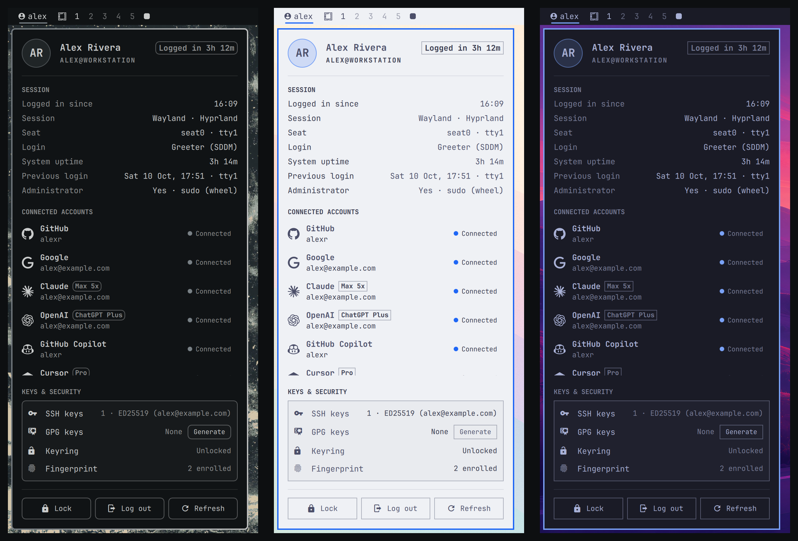

# User Menu for Omarchy

Shows who you're logged in as in the Omarchy bar. Click it to open a menu with your session details, the third-party accounts signed in on this machine, the state of your keys, and Lock / Log out buttons.



The menu takes all of its colors, fonts, borders and spacing from the active Omarchy theme. It restyles immediately when you run `omarchy theme set`, including while it's open.

## What's in it

| Section | Shows |
|---|---|
| **Header** | Your avatar (`~/.face`) or initials, full name, `user@host`, and how long you've been logged in |
| **Session** | When you logged in, session type and compositor, seat/TTY, how you logged in (autologin, greeter, SSH), system uptime, your previous login, and whether you have sudo |
| **Connected accounts** | Every account found locally: Git, GitHub, GitLab, Google, Gemini, Microsoft, Claude, OpenAI (Codex), Tailscale, Docker, AWS, Hugging Face. Each shows the identity, the plan where known (e.g. *Max 5x*, *ChatGPT Pro*), and a status |
| **Keys & security** | SSH keys, GPG keys, whether the login keyring is unlocked, and fingerprint enrollment. Missing keys get a **Generate** / **Set up** button that opens a terminal |
| **Footer** | Lock · Log out (asks first) · Refresh |

Durations use wall-clock time, so time spent suspended still counts.

## Install

```bash
omarchy plugin add https://github.com/TannerBurns/omarchy-user-menu --enable
```

By default the widget goes in the right section of the bar. To move it:

```bash
omarchy bar move tannerburns.user-menu --section right --before omarchy.power
```

**Update:** `omarchy plugin update tannerburns.user-menu`
**Remove:** `omarchy plugin remove tannerburns.user-menu`

### Requirements

Omarchy 4 (tested on 4.0.4), `bash`, `jq` and `python3`, all of which Omarchy already ships. No other dependencies.

## Using it

| Input | Action |
|---|---|
| Left click | Open or close the menu |
| Right click | Cycle the bar label: username → full name → hostname → user@host → icon only |
| Middle click | Reload your identity (name, hostname, session) |
| `Esc` / `Tab` | Close / switch to the next bar panel |
| `j` `k` | Scroll |
| `h` `l`, `Enter` | Move between buttons and press the selected one |
| `r` | Refresh |

To open it from the keyboard, add a binding to `~/.config/hypr/bindings.lua`:

```lua
o.bind("SUPER + CTRL + U", "User menu", "omarchy-shell shell toggle tannerburns.user-menu")
```

## Settings

Set with `omarchy bar set tannerburns.user-menu <key> <value>`:

| Key | Default | |
|---|---|---|
| `label` | `username` | `username`, `fullname`, `hostname`, `userhost`, or `none` (icon only). Vertical bars always show only the icon |
| `showIcon` | `true` | Show the account glyph before the label. When it's off, a vertical bar shows your initials instead |
| `hiddenProviders` | `""` | Providers to hide, comma-separated, e.g. `docker,aws` |
| `showSignedOut` | `true` | Also list tools that are set up but not signed in |
| `confirmLogout` | `true` | Ask before logging out |

```bash
omarchy bar set tannerburns.user-menu label fullname
omarchy bar set tannerburns.user-menu hiddenProviders "git,docker"
```

The full name comes from your account's GECOS field, then `git config user.name`, then your username. To set it system-wide, run `sudo chfn -f "Your Name" $USER`.

## Privacy

All of the data comes from [`bin/user-menu-probe`](bin/user-menu-probe), a read-only script that runs locally. It never contacts any service and never runs a provider's CLI. It runs once when the shell starts and again each time you open the menu; nothing polls in the background. The rules it follows:

1. It reads credential files with `jq`, using only explicit identity fields (email, login, plan). It checks whether a token is present by its *type*, without reading it.
2. It decodes the Codex ID token's payload inside `python3`, and prints only the email, plan and renewal date.
3. Token files (Docker auth, Hugging Face token, gcloud credential DBs, Gemini OAuth) are only checked for existence or section names.
4. Error output from other tools is never passed through.
5. A fail-closed guard checks the final output for anything shaped like a token (JWTs, `gho_`, `sk-…`, `hf_`, `AKIA…`, …). If it finds a match, it withholds the whole result.

"Connected" means a credential for that account is stored on this machine. It doesn't mean the provider would still accept it. Sign-in expiry is shown where it is stored locally: Claude's refresh token and AWS SSO sessions. Accounts within 7 days of expiry show **Expires in Nd**.

### Where each account comes from

| Provider | Source |
|---|---|
| Git | `git config --global user.name / user.email` |
| GitHub | `~/.config/gh/hosts.yml` (`user`) |
| GitLab | `~/.config/glab-cli/config.yml` |
| Google | Chromium / Chrome / Vivaldi `Local State` signed-in profiles, the active `gcloud` configuration, GNOME Online Accounts |
| Gemini | `~/.gemini/google_accounts.json` |
| Microsoft | Edge `Local State`, GNOME Online Accounts |
| Claude | `~/.claude.json` (`oauthAccount`) and `~/.claude/.credentials.json` (plan, refresh-token expiry) |
| OpenAI | `~/.codex/auth.json` (ID-token claims: email, ChatGPT plan, renewal) |
| Tailscale | `tailscale status --json` (local daemon socket) |
| Docker | `~/.docker/config.json` registry host names |
| AWS | `~/.aws/config` profile names, SSO cache expiry |
| Hugging Face | `~/.cache/huggingface/token` existence and stored token names |

To check what it reports on your machine:

```bash
bash ~/.config/omarchy/plugins/tannerburns.user-menu/bin/user-menu-probe | jq .
```

## Development

Work in a normal clone outside the plugins directory and install it from GitHub like any other user. Treat the copy under `~/.config/omarchy/plugins/` as an install only: `omarchy plugin update` won't fast-forward over local edits there.

```bash
git clone https://github.com/TannerBurns/omarchy-user-menu ~/Work/GitHub/omarchy-user-menu
cd ~/Work/GitHub/omarchy-user-menu
```

Before pushing, check from the work tree. The probe runs anywhere:

```bash
bash tests/run.sh               # probe tests in a throwaway HOME (fake tokens are generated at runtime)
bash tests/live-leak-check.sh   # check the probe against your real credentials; prints only OK or LEAK:<source>
bash bin/user-menu-probe | jq . # what the menu will show on this machine
omarchy plugin validate .
```

To try a change in the bar, push it and update the install:

```bash
git push
omarchy plugin update tannerburns.user-menu
omarchy restart shell           # needed after editing any QML file other than Widget.qml (the shell caches them)
```

`omarchy plugin update` always pulls the repo's default branch (`main`), so changes only reach the bar once they're on `main`. Shell logs: `quickshell log -p /usr/share/omarchy/shell -f`.

## Roadmap

- Per-account actions: open the dashboard, copy the identity, sign in again
- Unlock the keyring from the menu
- An optional online check (`gh auth status`) to confirm a sign-in still works
- A `maskIdentities` setting for screen sharing
- VS Code and Firefox accounts

## Credits

Provider logos come from [Simple Icons](https://simpleicons.org) 16.33.0 (CC0 1.0). Each mark is reduced to its path data with a white fill so the shell can tint it to your theme. They are trademarks of their respective owners, and using them doesn't imply endorsement. Simple Icons doesn't ship OpenAI or AWS marks, so those rows use Nerd Font glyphs.

## License

[MIT](LICENSE) © 2026 Tanner Burns
